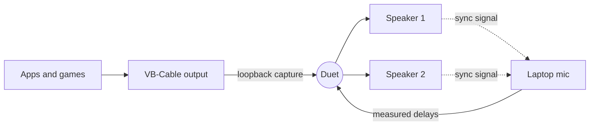

<div align="center">


# Duet

**Play your PC's audio on several speakers at once, in sync.**

Pair two Bluetooth speakers, a speaker and your headphones, or any mix of outputs. Duet keeps them lined up so they sound like one system, not an echo.

[](https://github.com/SSShogunn/duet/releases/latest)
[](https://github.com/SSShogunn/duet/actions/workflows/release.yml)


**[Download Duet for Windows](https://github.com/SSShogunn/duet/releases/latest)**

<br />

<a href="docs/duet-demo.mp4"></a>

<sub>Click the preview to watch the full video with sound.</sub>

</div>

---

## Why Duet

Windows plays sound on one output at a time. Bluetooth speakers also each add their own delay, often 100–300 ms, and the delay shifts while they play. Duet copies your audio to every speaker you pick and corrects those delays continuously.

| | |
|---|---|
| 🔊 **Any speakers** | Bluetooth, USB, HDMI, the laptop's own speakers, in any combination |
| 🤫 **Silent sync** | Lines speakers up with a 19–20.8 kHz signal most adults can't hear, measured by your laptop mic in about 7 seconds |
| 🎧 **Stereo pair** | Turn two speakers into a left and right pair, and swap sides with one click |
| 🎚️ **Windows volume works** | The normal volume slider and mute keys control every speaker |
| 🩹 **Drift correction** | Keeps speakers aligned while they play, with no audible jumps |
| 🌗 **Light and dark** | Follows your Windows theme, or pick one |

## Install

1. Download **Duet_x.y.z_x64-setup.exe** from the [latest release](https://github.com/SSShogunn/duet/releases/latest) and run it.
2. Install the free **[VB-Audio Virtual Cable](https://vb-audio.com/Cable/)** driver, then restart your PC. Duet listens to it, so this step is needed once.
3. Open Duet and follow the setup card. It ticks off each step as you go.

> [!NOTE]
> The installer isn't code-signed yet, so Windows may show **"Windows protected your PC"**. Click **More info**, then **Run anyway**.

## Using Duet

1. Set your Windows sound output to the VB-Cable output (**CABLE Input**, or whatever you renamed it to).
2. Switch on the speakers you want in Duet.
3. Press **Sync**. Stay quiet for a few seconds while the laptop mic listens.

Duet also syncs on its own a few seconds after your speakers connect. Closing the window keeps it running in the tray.

## How it works



1. Windows sends all sound to the VB-Cable virtual output.
2. Duet captures that output and gives each speaker its own buffer.
3. To sync, each speaker plays a short sweep at once: one rising, one falling. Duet finds each sweep in the mic recording, measures how late each speaker is, and delays the faster ones to match.
4. While playing, Duet speeds each speaker up or slows it down by at most 0.5% to stop slow drift. That change is too small to hear.

<details>
<summary><b>Troubleshooting</b></summary>

<br />

| Problem | Fix |
|---|---|
| **Sync says the chimes were muted** | Your laptop's AI noise cancelling is removing the sync sound. Turn it off in the laptop's audio app, for example *Lenovo Vantage → Microphone noise cancelling → Off*. |
| **Sync keeps failing** | Switch **Options → Sync sound** to **Chime**. Some speakers or mics can't carry very high pitches. Duet also tries the chime by itself when silent sync fails. |
| **Crackling on one speaker** | That speaker's Bluetooth link is dropping. Move it closer, remove and re-pair it in Windows, and make sure it isn't also connected to a phone. |
| **One speaker slowly falls behind** | Press **Sync** again. Bluetooth speakers add delay after a dropout. |
| **"A speaker was disconnected"** | Turn the speaker back on. Duet picks it up again automatically. |

Logs live in `%LOCALAPPDATA%\com.sshogunn.audio-spil\logs\duet.log`. Open the folder from **☰ → Open log folder**, and turn on **Debug logging** there for more detail.

</details>

<details>
<summary><b>Build from source</b></summary>

<br />

You need [Rust](https://rustup.rs), [Node.js](https://nodejs.org) 22 or newer, [pnpm](https://pnpm.io), and VB-Audio Virtual Cable.

```powershell
pnpm install
pnpm tauri dev
```

Build the installer:

```powershell
pnpm tauri build
```

It lands in `src-tauri\target\release\bundle\nsis\`.

Run the tests:

```powershell
cd src-tauri
cargo test --lib
```

The real-speaker tests are skipped by default. Run them with `cargo test --lib -- --ignored --nocapture` while Duet is closed and the VB-Cable output is your Windows default.

**Built with** [Tauri 2](https://tauri.app), Rust ([wasapi](https://crates.io/crates/wasapi), [rustfft](https://crates.io/crates/rustfft)), React, Tailwind CSS and [Lucide](https://lucide.dev) icons.

</details>

<details>
<summary><b>Releasing a new version</b></summary>

<br />

1. Set the same version in `package.json`, `src-tauri/tauri.conf.json` and `src-tauri/Cargo.toml`.
2. Commit, then tag and push:

```powershell
git tag v0.2.0
git push origin v0.2.0
```

GitHub Actions runs the tests, builds the installer and publishes it on the [Releases](https://github.com/SSShogunn/duet/releases) page. The build stops if the tag doesn't match the app version.

</details>

## Credits

Duet relies on **[VB-Audio Virtual Cable](https://vb-audio.com/Cable/)** by VB-Audio Software. It's donationware, so support them if Duet is useful to you.
